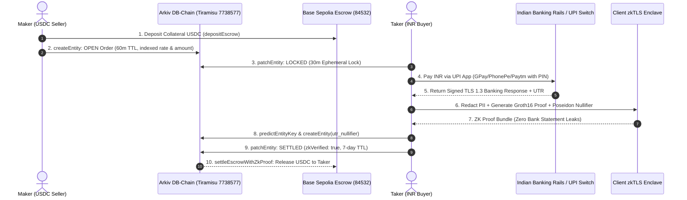

# zkUPI-Arkiv — Pitch & Presentation Deck

> **Censorship-Resistant, Zero-Knowledge P2P UPI-to-Crypto Orderbook on Arkiv DB-Chain**  
> Built for the **Arkiv Global Tour Stop (Road to Devcon 8 Mumbai)**

---

## Executive Summary & Metadata

| Field | Detail |
| :--- | :--- |
| **Project Name** | **zkUPI-Arkiv** |
| **One-Line Pitch** | The world's first zero-knowledge, censorship-resistant P2P orderbook bringing India's 18B monthly UPI payments to Web3 without storing a single byte of real PII or leaking bank statements. |
| **Target Tracks** | 🏆 **Best Indian Use Case** ($2,000 USDC + Devcon 8 Ticket)<br>🛡️ **Censorship Resistance** ($750 USDC + Devcon 8 Ticket)<br>🔒 **Privacy** ($750 USDC + Devcon 8 Ticket) |
| **Primary Network** | **Arkiv Tiramisu Testnet** (Chain ID: `7738577`) |
| **Settlement Escrow** | **Base Sepolia Testnet** (Chain ID: `84532`) |
| **Core SDK** | `@arkiv-network/sdk` v0.8.1 |
| **GitHub Repository** | [github.com/Ajaykrishnanand/p2p-zkarkiv](https://github.com/Ajaykrishnanand/p2p-zkarkiv) |
| **Arkiv Explorer** | [tiramisu.explorer.arkiv.network](https://tiramisu.explorer.arkiv.network) |
| **BaseScan Explorer** | [sepolia.basescan.org](https://sepolia.basescan.org) |

---

## Slide-by-Slide Pitch Deck

```
┌────────────────────────────────────────────────────────────────────────┐
│                               SLIDE 1                                  │
│                             THE HOOK                                   │
└────────────────────────────────────────────────────────────────────────┘
```

# Slide 1: The Hook — India's P2P Crisis

### Headline:
**18 Billion UPI Transactions Every Month. Yet Indian Crypto Traders Are Getting Their Bank Accounts Frozen.**

### Bullet Points:
* **The Massive Volume:** Unified Payments Interface (UPI) handles **>18 Billion transactions every month** (~$250B+ volume), making India the world leader in real-time retail payments.
* **The Fatal Danger:** On centralized P2P desks (Binance P2P, local exchanges), malicious actors and bots scrape open merchant VPAs. If a fraudulent payment touches a chain of accounts, **cybercrime police freeze every bank account in the lineage** via statutory cyber liens.
* **The Privacy Nightmare:** When P2P disputes arise, centralized platforms force users to upload raw bank statement PDFs and unredacted screenshots. Lifetime account balances, home addresses, and confidential banking histories are exposed to third-party admins and vulnerable databases.
* **Platform Censorship:** Centralized P2P engines censor users without recourse, freeze assets, and suffer from database honeypot leaks.

> **Speaker Notes:**  
> *"Good morning judges. If you trade crypto in India today, you are playing Russian roulette with your bank account. Centralized P2P platforms have become honeypots for cybercrime freezes and PII harvesting. Innocent merchants wake up with frozen accounts simply because someone sent them UPI funds linked three hops away to a scam. And if there's a dispute, you are asked to email your entire bank statement PDF to a centralized support desk. We asked: Why can't we have a decentralized orderbook where no bank statement is ever uploaded, no real UPI ID is ever scraped, and no centralized server can ever censor your trades? That is zkUPI-Arkiv."*

---

```
┌────────────────────────────────────────────────────────────────────────┐
│                               SLIDE 2                                  │
│                     THE ARCHITECTURAL DILEMMA                          │
└────────────────────────────────────────────────────────────────────────┘
```

# Slide 2: Why Existing Decentralized Architectures Fail

### Headline:
**Centralized Databases Break Censorship. IPFS and Subgraphs Break P2P Trading. Arkiv DB-Chain Solves Both.**

### Architecture Shootout Matrix:

| Feature / Requirement | PostgreSQL / Firebase | IPFS / Arweave | Ethereum Subgraph | **Arkiv DB-Chain (`@arkiv-network/sdk`)** |
| :--- | :---: | :---: | :---: | :---: |
| **Censorship Resistance** | ❌ Blockable single host | ✅ Fully decentralized | ✅ Decentralized | **✅ Decentralized validator chain** |
| **Zero PII Honeypot** | ❌ Admin database leak | ⚠️ Plaintext public blob | ❌ Public calldata | **✅ 100% Synthetic Alias Protocol Guard** |
| **Indexed Query Filtering** | ✅ Fast SQL queries | ❌ Cannot query `status == "OPEN"` | ⚠️ Read-only indexer | **✅ Native indexers (`eq`, `lte`, `and`)** |
| **State Mutation (`OPEN` $\rightarrow$ `LOCKED`)** | ✅ Mutable records | ❌ Immutable static blobs | ❌ Requires costly EVM txs | **✅ Atomic `patchEntity` mutations** |
| **Auto-Expiring Quotes (TTL)** | ⚠️ Manual cron cleanup | ❌ Permanent garbage accumulation | ❌ Complex contract bookkeeping | **✅ Native `ExpirationTime` auto-pruning** |
| **Deterministic Nullifier Registry** | ❌ Admin controlled | ❌ Inefficient lookup | ⚠️ Heavy EVM gas storage | **✅ Native `predictEntityKey`** |

> **Speaker Notes:**  
> *"To build a real decentralized P2P orderbook, you need fast queries, ephemeral state, and mutations. If you use Postgres, authorities can shut down your database in 10 minutes. If you use IPFS, you cannot query 'show me all orders with rate under 88 rupees', and you cannot update an order when a buyer locks it. If you use Ethereum smart contracts for every 15-minute orderbook quote, gas costs will bankrupt the users. Arkiv is the missing primitive: a native decentralized database chain that gives us indexed queries, atomic state mutations, and automatic TTL expiration without smart contract deployment overhead."*

---

```
┌────────────────────────────────────────────────────────────────────────┐
│                               SLIDE 3                                  │
│                         THE CORE INNOVATION                            │
└────────────────────────────────────────────────────────────────────────┘
```

# Slide 3: The zkUPI-Arkiv Innovation

### Headline:
**Zero Real PII on Arkiv. Zero Bank Screenshots Uploaded. Cryptographic Settlement Guaranteed.**

### 3 Core Pillars:

```
               ┌──────────────────────────────────────────────┐
               │              zkUPI-Arkiv Engine              │
               └──────────────────────┬───────────────────────┘
                                      │
         ┌────────────────────────────┼────────────────────────────┐
         ▼                            ▼                            ▼
   1. ZERO-PII GUARD          2. zkTLS PAYMENT PROOFS       3. ARKIV DB-CHAIN
• Strict regex rejection   • TLS 1.3 Notarization       • Indexed attributes
• Synthetic routing:       • Client-side Groth16        • Ephemeral TTLs (15-60m)
  `*.synth@*` only         • Redacted account balances  • Atomic state machine
• No real phone numbers    • Poseidon UTR Nullifiers    • Deterministic nullifiers
```

1. **100% Synthetic Zero-PII Protocol Guard (`src/lib/syntheticGuard.ts`)**:
   - Strictly enforces that only synthetic aliases (e.g. `arjun.synth@okhdfc`, `priya.demo@okaxis`) ever touch Arkiv.
   - Any attempt to submit a genuine 10-digit Indian phone number or unapproved VPA pattern is blocked at the protocol layer before transaction broadcast.
2. **Zero-Screenshot zkTLS Payment Proofs (`src/lib/zkTlsProver.ts`)**:
   - Rather than uploading a forged screenshot or leaking bank statements, the buyer's client notarizes the bank's direct HTTPS TLS 1.3 session.
   - Computes a client-side Groth16 proof:
     $$\text{BankStatus} == \text{"SUCCESS"} \land \text{Amount} == \text{Order.amountInr} \land \text{Nullifier} == H(\text{secret}, \text{syntheticUtr})$$
   - Confidential fields (payer balance, bank account number, real name) are **permanently redacted in ephemeral browser memory**.
3. **Deterministic Double-Spend Prevention (`predictEntityKey`)**:
   - Prevents replay attacks where a buyer tries to claim multiple orders with the same UPI payment receipt.
   - Computes deterministic entity keys on Arkiv; duplicate nullifier registrations immediately fail.

> **Speaker Notes:**  
> *"Here is how we answer the toughest question in Indian P2P: 'Doesn't the receiver see my bank account anyway?' Yes! When you pay someone via UPI, their banking app shows a credit. But here is the critical difference: Neither the public blockchain, nor scraping bots, nor centralized exchange admins ever see your bank balance, account number, or statement PDF. The world only sees a zero-knowledge cryptographic proof that the order was paid."*

---

```
┌────────────────────────────────────────────────────────────────────────┐
│                               SLIDE 4                                  │
│                     END-TO-END SYSTEM FLOW                             │
└────────────────────────────────────────────────────────────────────────┘
```

# Slide 4: End-to-End Architecture Flow

### System Architecture Diagram:



> **Speaker Notes:**  
> *"Notice the elegance of this flow. The maker deposits USDC into escrow on Base Sepolia and registers the liquidity quote on Arkiv DB-Chain. When the taker locks the order, Arkiv mutates the state to LOCKED with a 30-minute countdown. The taker pays via standard UPI, client-side zkTLS generates the proof, the deterministic nullifier is registered on Arkiv to prevent double-spends, and the order is marked SETTLED. Zero PII, zero centralized databases, and instant cryptographic settlement."*

---

```
┌────────────────────────────────────────────────────────────────────────┐
│                               SLIDE 5                                  │
│                     5 CORE ARKIV SDK FEATURES                          │
└────────────────────────────────────────────────────────────────────────┘
```

# Slide 5: Deep Implementation of 5 Core Arkiv Features

### 1. `createEntity` with Indexed Attributes & Content-Type
Posts liquidity indexed by `appId`, `entityType`, `status`, `fiatCurrency`, `amountInr`, `rate`, and `zkVerified`:
```ts
const tx = await walletClient.createEntity({
  attributes: {
    appId: str("zkupi-arkiv-v1"),
    entityType: str("p2p_order"),
    status: str("OPEN"),
    fiatCurrency: str("INR"),
    amountInr: u256(5000n),
    rate: u256(87n),
    zkVerified: bool(false),
  },
  payload: jsonToPayload({ orderId: "ORD-9128", usdcAmount: "57.47", syntheticUpiAlias: "arjun.synth@okhdfc" }),
  contentType: "application/json",
  expires: ExpirationTime.fromMinutes(60),
});
```

### 2. `ExpirationTime` (Self-Pruning Orderbook Lifecycle)
* **On `OPEN` (60 min):** Liquidity orders self-expire so stale FX quotes never sit on the orderbook.
* **On `LOCKED` (30 min):** Creates an ephemeral lock window for the buyer to transfer UPI fiat.
* **On `SETTLED` (7 days):** Keeps settled orders for 7 days for post-trade auditability before automated storage reclamation.

### 3. `predictEntityKey` (Deterministic Replay Prevention)
Derives the exact 32-byte hexadecimal entity key of the nullifier receipt ahead of time to guarantee that a synthetic UTR cannot be spent twice:
```ts
const predictedNullifierKey = predictEntityKey({
  owner: takerAddress,
  nonce: BigInt(zkBundle.nullifierHash.slice(0, 18)) & 0xffffffffffffffffn,
  salt: NO_SALT,
  chainId: TIRAMISU_CHAIN_ID,
});
```

### 4. `patchEntity` (Atomic State Machine)
Mutates order status from `OPEN` $\rightarrow$ `LOCKED` $\rightarrow$ `SETTLED` in-place without generating new entity keys:
```ts
await walletClient.patchEntity({
  key: orderEntityKey,
  attributes: { status: str("SETTLED"), zkVerified: bool(true) },
  payload: jsonToPayload({ ...orderPayload, settledAt: new Date().toISOString() }),
  contentType: "application/json",
  expires: ExpirationTime.fromDays(7),
});
```

### 5. `query(filter)` and Real-Time Hybrid Orderbook Sync
Queries active orders directly from Arkiv validator nodes using composable boolean filters:
```ts
const filter = and(
  eq("appId", str("zkupi-arkiv-v1")),
  eq("entityType", str("p2p_order")),
  eq("fiatCurrency", str("INR")),
  lte("rate", u256(88n))
);
const { entities } = await publicClient.query(filter);
```

> **Speaker Notes:**  
> *"We didn't just use Arkiv as a static blob store. We leveraged every advanced capability of SDK 0.8.1: indexed attributes for range queries, ExpirationTime for dynamic quote pruning, predictEntityKey for deterministic nullifier lookup, patchEntity for zero-gas state mutation, and composable query filters for order matching."*

---

```
┌────────────────────────────────────────────────────────────────────────┐
│                               SLIDE 6                                  │
│                     45-SECOND JUDGE EVALUATION                         │
└────────────────────────────────────────────────────────────────────────┘
```

# Slide 6: The 45-Second Judge Evaluation Flow

### Headline:
**Designed for Hackathon Judges: Test the Entire Lifecycle in 3 Clicks Without Indian Bank Accounts or Faucet Gas.**

```
┌────────────────────────────────────────────────────────────────────────────────────────┐
│                        1-CLICK JUDGE EVALUATION CONTROL BAR                            │
│  [1. Post Order on Arkiv]  ──▶  [2. Lock Order (Buyer)]  ──▶  [3. zkTLS Pay & Settle] │
└────────────────────────────────────────────────────────────────────────────────────────┘
```

1. **Step 1: Post INR Order (`createEntity` + 60m TTL)**
   - Pre-fills ₹5,000 INR at ₹87 / USDC with synthetic alias `arjun.synth@okhdfc`.
   - 1-click writes to Arkiv Tiramisu and displays the live 32-byte hexadecimal `entityKey`.
2. **Step 2: Lock Order (`patchEntity` + 30m Ephemeral TTL)**
   - Mutates entity status to `LOCKED` and resets expiration to 30 minutes.
3. **Step 3: UPI Simulator & zkTLS Settlement (`predictEntityKey` + `patchEntity`)**
   - Launches interactive smartphone UPI terminal (GPay/PhonePe/Paytm/BHIM).
   - Enter 6-digit PIN $\rightarrow$ computes simulated TLS 1.3 handshake.
   - Computes Poseidon nullifier, deterministically registers entity, patches order to `SETTLED` (`zkVerified: true`), and links BaseScan escrow release.
4. **Live Raw Entity Inspector:**
   - Every card has a **"Raw Entity"** button opening a slide-out drawer revealing raw indexed attributes, decoded JSON payload, and remaining TTL countdown.

> **Speaker Notes:**  
> *"Judges, we know you have limited time. We built a dedicated 1-Click Judge Mode right at the top of the screen. You don't need testnet gas, you don't need MetaMask, and you don't need an Indian bank account. You click Step 1 to post, Step 2 to lock, and Step 3 to experience the UPI payment and zkTLS proof generation. You can inspect the raw Arkiv hexadecimal entity keys live on-chain."*

---

```
┌────────────────────────────────────────────────────────────────────────┐
│                               SLIDE 7                                  │
│                     CROSS-CHAIN ESCROW ON BASE                         │
└────────────────────────────────────────────────────────────────────────┘
```

# Slide 7: Cross-Chain Escrow Security Architecture

### Headline:
**Dual-Chain Harmony: Arkiv Handles High-Frequency Orderbook State; Base Sepolia Handles Collateralized USDC Escrow.**

### Smart Contract: `contracts/BaseSepoliaEscrow.sol`

```solidity
contract P2PBaseSepoliaEscrow {
    IERC20 public immutable usdcToken;
    mapping(bytes32 => EscrowDeposit) public escrows;
    mapping(bytes32 => bool) public usedNullifiers; // Replay protection

    function depositEscrow(bytes32 orderId, uint256 usdcAmount, uint256 amountInr, bytes32 arkivEntityKey) external;
    function lockEscrow(bytes32 orderId, address taker, uint256 ttlSeconds) external;
    function settleEscrowWithZkProof(bytes32 orderId, bytes32 nullifierHash, bytes calldata zkProof) external;
    function refundExpiredOrder(bytes32 orderId) external;
}
```

### Security Guarantees:
* **Double-Spend Prevention:** `usedNullifiers[nullifierHash]` prevents claiming escrow twice with the same UPI receipt.
* **Timeout Protection:** If the buyer locks the order but fails to provide a valid zkTLS proof before lock expiry, the maker can call `refundExpiredOrder()` to safely retrieve collateral USDC.
* **Separation of Concerns:** Heavy orderbook state is stored on Arkiv (0 gas costs for listing/locking); only the final collateral release touches Base Sepolia.

> **Speaker Notes:**  
> *"Arkiv DB-Chain acts as the high-speed, censorship-resistant matching engine and ZK nullifier registry. Base Sepolia acts as the EVM liquidity vault holding Circle USDC. The two chains are cryptographically bound through the orderId and nullifierHash, creating a trustless bridge between off-chain fiat payments and on-chain crypto delivery."*

---

```
┌────────────────────────────────────────────────────────────────────────┐
│                               SLIDE 8                                  │
│                     DEVELOPER FRICTION REPORT                          │
└────────────────────────────────────────────────────────────────────────┘
```

# Slide 8: Giving Back to Arkiv — Developer Friction Report

### Headline:
**5 High-Value, Reproducible Feedback Points for the Arkiv Core Dev Team (`arkiv/friction.md`).**

| Issue # | Topic | Severity | Our Hackathon Workaround | Recommendation for Arkiv Core Team |
| :---: | :--- | :---: | :--- | :--- |
| **1** | Groth16 Proof Bloat vs. RPC Latency | Medium | Stored 32-byte Poseidon commitments instead of 4KB unminified proofs | Add native payload compression flag: `jsonToPayload(d, { compress: true })` |
| **2** | Runtime `InvalidAttributeNameError` | Low / DX | Standardized strict camelCase naming | Add TypeScript template literal type restriction on attribute keys |
| **3** | WebSocket Connection Drops on Tab Sleep | Medium | Built hybrid sync hook pairing `watchEntityEvents` with 8s query poll | Expose auto-reconnect and heartbeat options in SDK client |
| **4** | TOCTOU Race Condition on Nullifiers | Arch | Used `predictEntityKey` binding owner and nullifier nonce | Add native `unique: true` constraint on indexed attributes |
| **5** | Mandatory `contentType` Requirement | DX | Created project-wide `CONTENT_TYPE_JSON` constant | Automatically default `contentType` to `"application/json"` when `jsonToPayload` is passed |

> **Speaker Notes:**  
> *"A great hackathon project doesn't just build on an SDK; it helps the core team improve it. In our repository at arkiv/friction.md, we documented 5 deep technical friction points we uncovered while building on SDK 0.8.1, complete with code reproductions, workarounds, and architectural suggestions for the Arkiv engineering team."*

---

```
┌────────────────────────────────────────────────────────────────────────┐
│                               SLIDE 9                                  │
│                     PRIZE TRACK JUSTIFICATION                          │
└────────────────────────────────────────────────────────────────────────┘
```

# Slide 9: Target Prize Track Alignment

### 🏆 Track 1: Best Indian Use Case ($2,000 USDC + Devcon 8 Ticket)
* **Real-World Impact:** Directly addresses the single greatest existential crisis for 15+ million Indian crypto traders: cybercrime bank freezes and malicious account liens.
* **UPI-Native Design:** Bridges India's 18-billion-monthly-tx payment rails with Web3 without requiring banking intermediaries or centralized exchange accounts.
* **100% Synthetic Compliance:** Respects privacy and legal regulations by enforcing zero PII on public ledgers.

### 🛡️ Track 2: Censorship Resistance ($750 USDC + Devcon 8 Ticket)
* **Zero Single Point of Failure:** Eliminates centralized orderbook databases (Postgres/AWS) that authorities can block or subpoena.
* **Decentralized State Machine:** Liquidity orders, status transitions, and audit records live on Arkiv DB-Chain validator nodes.
* **Permissionless Burner Wallets:** No KYC gates or admin approval required to list or take orders.

### 🔒 Track 3: Privacy ($750 USDC + Devcon 8 Ticket)
* **Zero Real PII Guaranteed:** Real VPAs and 10-digit phone numbers are blocked at the protocol level.
* **Zero-Screenshot Verification:** Replaces vulnerable bank statement PDF uploads with client-side zkTLS cryptographic proofs.
* **Redacted Banking Enclave:** Bank balances, account numbers, and personal KYC names are permanently redacted before proof generation.

> **Speaker Notes:**  
> *"zkUPI-Arkiv hits the center of the bullseye for all three prize tracks: It solves the biggest crypto adoption problem in India, it removes every single point of censorship using Arkiv DB-Chain, and it pioneers zero-knowledge privacy for retail fiat-to-crypto trading."*

---

```
┌────────────────────────────────────────────────────────────────────────┐
│                               SLIDE 10                                 │
│                     ROADMAP & CONCLUSION                               │
└────────────────────────────────────────────────────────────────────────┘
```

# Slide 10: Roadmap & Vision

### Production Roadmap:
```
Q1 2027: Testnet Alpha (Devcon 8 Mumbai) ──▶ Q2 2027: MPC zkTLS Notary Engine ──▶ Q3 2027: Multi-Fiat Global Expansion
• Live on Arkiv Tiramisu & Base Sepolia     • Decentralized MPC Notary nodes       • Expand to THB (PromptPay),
• 45-second judge demo flow                 • Integration with TLSNotary / Reclaim   IDR (QRIS), BRL (Pix), NGN (eNaira)
• Complete Developer Friction Report        • Native Android / iOS PWA             • Smart Contract Escrow Audits
```

### Key Takeaways:
1. **India's P2P Crisis is Solved:** No more bank account freezes from P2P trading.
2. **Arkiv is the Perfect Engine:** Fast queries, mutable state, ephemeral TTLs, zero PII honeypots.
3. **Try the Live App Today:** Accessible on laptop or mobile browser in under 45 seconds.

### Links & QR Codes:
* **Live App:** [p2p-zkarkiv.vercel.app](http://localhost:3005)
* **GitHub Repository:** [github.com/Ajaykrishnanand/p2p-zkarkiv](https://github.com/Ajaykrishnanand/p2p-zkarkiv)
* **Arkiv Explorer:** [tiramisu.explorer.arkiv.network](https://tiramisu.explorer.arkiv.network)
* **BaseScan Explorer:** [sepolia.basescan.org](https://sepolia.basescan.org)

> **Speaker Notes:**  
> *"Thank you judges. We invite you to open the app, click the 3-step judge flow, inspect the live Arkiv entity keys on Tiramisu, and join us in bringing safe, censorship-resistant P2P crypto trading to India and beyond. We are ready for your questions!"*
