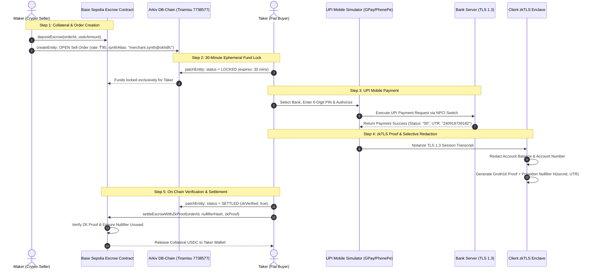

# PhantomUPI — Pitch Deck & Live Demo Runbook

> **Censorship-Resistant, Zero-Knowledge P2P UPI-to-Crypto Orderbook on Arkiv DB-Chain**  
> Built for the **Arkiv Global Tour Stop (Road to Devcon 8 Mumbai)**  
> 
> **Presentation Breakdown:**
> - 📊 **[PART 1: The Pitch Deck (Presentation Using PPT / Slides)](#part-1-the-pitch-deck-presentation-using-ppt)** (3–4 Minutes)
> - 💻 **[PART 2: Live Website Demo Script & Walkthrough](#part-2-live-website-demo-script--walkthrough)** (4–5 Minutes)

---

## Executive Summary & Quick Reference

| Attribute | Detail |
| :--- | :--- |
| **Project Name** | **PhantomUPI** |
| **One-Line Pitch** | The first decentralized P2P crypto orderbook where Arkiv DB-Chain manages ephemeral 30-min escrow locks and client-side zkTLS proves Indian UPI bank payments without leaking bank statements or risking cybercrime liens. |
| **Target Tracks** | 🏆 **Best Indian Use Case** ($2,000 USDC + Devcon 8 Ticket)<br>🛡️ **Censorship Resistance** ($750 USDC + Devcon 8 Ticket)<br>🔒 **Privacy** ($750 USDC + Devcon 8 Ticket) |
| **Core Flow** | **Maker posts Sell Order** $\rightarrow$ **Funds locked in 30-min Escrow** $\rightarrow$ **Buyer pays via UPI Simulator** $\rightarrow$ **zkTLS proves payment authentic from bank** $\rightarrow$ **Escrow automatically releases USDC**. |
| **Live Web App** | [https://p2p-zkarkiv.vercel.app](https://p2p-zkarkiv.vercel.app) |
| **GitHub Repository** | [github.com/Ajaykrishnanand/p2p-zkarkiv](https://github.com/Ajaykrishnanand/p2p-zkarkiv) |
| **Orderbook DB-Chain** | **Arkiv Tiramisu Testnet** (Chain ID: `7738577`) |
| **Collateral Escrow** | **Base Sepolia Testnet** (Chain ID: `84532`) |
| **Base Sepolia Escrow** | [`0xe43113320abe84a5c155016bc21cd9abceedfb05`](https://sepolia.basescan.org/address/0xe43113320abe84a5c155016bc21cd9abceedfb05) |
| **Base Sepolia USDC** | `0x036CbD53842c5426634e7929541eC2318f3dCF7e` |
| **Circle USDC Faucet** | [faucet.circle.com](https://faucet.circle.com) (Claim 10 USDC on Base Sepolia) |
| **Arkiv GLM Faucet** | [hub.arkiv.network/faucet](https://hub.arkiv.network/faucet) (Claim 100 GLM on Tiramisu) |
| **Arkiv Explorer** | [tiramisu.explorer.arkiv.network](https://tiramisu.explorer.arkiv.network) |
| **BaseScan Explorer** | [sepolia.basescan.org](https://sepolia.basescan.org) |

---

# PART 1: THE PITCH DECK (Presentation Using PPT)

*Recommended Duration: 3 to 4 Minutes*

```
┌────────────────────────────────────────────────────────────────────────┐
│                               SLIDE 1                                  │
│                             THE HOOK                                   │
└────────────────────────────────────────────────────────────────────────┘
```

## Slide 1: The Hook — India's P2P Crypto Crisis

### Visual Headline:
> **18 Billion UPI Payments Monthly. Yet Indian Crypto Traders Face Bank Account Freezes & Statement Leaks.**

### Slide Content & Data Points:
* **The Monumental Scale of UPI:** India’s Unified Payments Interface (UPI) processes over **18 Billion transactions every month** (~$250 Billion retail volume). It is the undisputed gold standard for retail transactions globally.
* **The P2P Freeze Trap:** On centralized P2P desks (Binance, Bybit, local centralized exchanges), sellers publish real UPI IDs. When tainted fiat enters any chain of payments, cybercrime police order blanket statutory **liens and freeze every bank account in the transaction lineage**.
* **The Privacy Catastrophe:** Whenever payment disputes arise, centralized platforms demand that users email raw bank statement PDFs and unredacted mobile banking screenshots. Sensitive personal data—total bank balances, personal transactions, home addresses—is exposed to third-party offshore support agents.
* **Photoshop Fraud:** Without cryptographic provenance, dishonest sellers claim "I never received the funds," while fraudulent buyers submit Photoshop-edited payment receipts.

### Speaker Notes (30–45 Seconds):
> *"Good morning, judges. In India today, UPI is king with 18 billion monthly transactions. But if you try to buy or sell crypto with UPI on centralized P2P desks, you are walking into a legal minefield. Centralized exchanges force you to expose your real UPI ID, and if any tainted money touches your account, your entire bank account gets frozen under cybercrime liens. Worse, when there is a dispute, you are forced to upload sensitive bank statements to offshore support desks.  
> Why can’t we trade peer-to-peer where the crypto is locked safely in decentralized escrow, the buyer pays through UPI, and zero-knowledge TLS cryptographically proves that the bank approved the transfer without exposing a single line of your private statement? That is PhantomUPI."*

---

```
┌────────────────────────────────────────────────────────────────────────┐
│                               SLIDE 2                                  │
│                     THE ARCHITECTURAL DILEMMA                          │
└────────────────────────────────────────────────────────────────────────┘
```

## Slide 2: Why Existing Decentralized Stacks Fail

### Visual Headline:
> **Centralized Databases Break Censorship. IPFS Cannot Mutate or Expire State. Arkiv DB-Chain Solves Both.**

### Architectural Comparison Matrix:

| Requirement | Centralized DB (Postgres/Firebase) | Decentralized Storage (IPFS/Arweave) | L1/L2 Calldata (Ethereum/Base) | **PhantomUPI on Arkiv DB-Chain (`@arkiv-network/sdk`)** |
| :--- | :---: | :---: | :---: | :---: |
| **Censorship Resistance** | ❌ Single point of failure; seized by injunction | ✅ Decentralized nodes | ✅ Decentralized consensus | **✅ Decentralized validator DB-chain** |
| **Zero-PII Storage** | ❌ Cleartext database leaks | ⚠️ Public permanent blob leak | ❌ Public calldata leak | **✅ 100% Synthetic Payee Protocol Guard** |
| **30-Min Ephemeral Lock** | ⚠️ Relies on fragile centralized cron jobs | ❌ Immutable; cannot expire state | ❌ Prohibitive gas for timer storage | **✅ Native `ExpirationTime.fromMinutes(30)`** |
| **In-Place State Mutation** | ✅ Mutable records | ❌ Static blobs; cannot mutate in-place | ❌ High gas contract state changes | **✅ Atomic `patchEntity` mutations** |
| **Fast Orderbook Querying** | ✅ Fast indexing | ❌ No native boolean query engine | ⚠️ Slow event log indexing | **✅ Decentralized query engine (`query(filter)`)** |
| **Replay Defense (Nullifiers)** | ❌ Relies on single database row | ❌ Expensive global lookups | ⚠️ High EVM gas per trade | **✅ Native `predictEntityKey` deterministic lookup** |

### Speaker Notes (30 Seconds):
> *"To build an on-chain P2P orderbook, you need fast queries, ephemeral locks, and atomic state transitions. If you use Postgres or AWS, a single legal notice shuts your exchange down in minutes. If you use IPFS, you cannot mutate an order from OPEN to LOCKED, nor can you give it an automatic 30-minute expiration countdown. If you put every quote and state update on Ethereum, gas fees kill retail adoption. Arkiv DB-Chain gives us native decentralized database primitives: indexed queries, atomic in-place state mutations via patchEntity, and native TTL expiration."*

---

```
┌────────────────────────────────────────────────────────────────────────┐
│                               SLIDE 3                                  │
│                         THE CORE INNOVATION                            │
└────────────────────────────────────────────────────────────────────────┘
```

## Slide 3: The 4-Step PhantomUPI Lifecycle

### Visual Headline:
> **Maker Lists Sell Order $\rightarrow$ 30-Min Escrow Lock $\rightarrow$ UPI Mobile Pay $\rightarrow$ zkTLS Proof Releases Crypto.**

```
┌────────────────────────────────────────────────────────────────────────────────────────────────────────────────────────┐
│                                                THE 4-STEP LIFECYCLE                                                    │
│                                                                                                                        │
│   [ 1. MAKER: SELL ORDER ]             [ 2. 30-MIN ESCROW LOCK ]              [ 3. TAKER: UPI SIMULATOR ]              │
│   • Maker deposits USDC to Escrow      • Taker locks order on Arkiv           • Taker selects bank & enters PIN        │
│   • Sets rate, amount & synth alias    • Escrow funds locked for 30 mins      • Payment routed via NPCI switch         │
│   • Broadcasts `createEntity`          • Status mutates to `LOCKED`           • Generates bank receipt with UTR        │
│                    │                                   │                                      │                        │
│                    └───────────────────────────────────┼──────────────────────────────────────┘                        │
│                                                        ▼                                                               │
│                                        [ 4. zkTLS PROOF & ESCROW RELEASE ]                                             │
│                                        • Client notarizes TLS 1.3 banking session                                      │
│                                        • Private bank balance & account number 100% REDACTED                           │
│                                        • Groth16 proof + Poseidon Nullifier verified by Escrow                         │
│                                        • Locked USDC automatically released to Taker!                                  │
└────────────────────────────────────────────────────────────────────────────────────────────────────────────────────────┘
```

### Key Pillars:
1. **Maker Lists Collateralized Order:** Maker deposits USDC into the Base Sepolia Escrow contract (`0xe431...`). The order is broadcast to Arkiv DB-Chain via `createEntity` with accurate INR pricing down to the exact paise.
2. **30-Minute Ephemeral Escrow Lock:** Buyer commits to buy. Arkiv DB-Chain mutates order status to `LOCKED` via `patchEntity` with `ExpirationTime.fromMinutes(30)`. The escrowed USDC is reserved exclusively for 30 minutes. If unpaid, it auto-reverts to the seller.
3. **Buyer Pays via UPI Mobile Simulator:** Buyer uses the interactive smartphone simulator (Google Pay, PhonePe, Paytm, BHIM), enters their 6-digit PIN, and executes the fiat payment via the simulated NPCI switch.
4. **zkTLS Provenance & Crypto Release:** The client-side zkTLS enclave captures the TLS 1.3 session from the bank (`api.retail.hdfcbank.com:443`). Private bank balances and account numbers are **redacted**. The Base Sepolia Escrow contract cryptographically verifies the proof and releases USDC to the buyer.

### Speaker Notes (45 Seconds):
> *"Here is the complete user journey:  
> Step 1: The seller deposits USDC into the Base Sepolia escrow and broadcasts their quote to Arkiv DB-Chain.  
> Step 2: The buyer clicks Lock & Pay. Arkiv mutates the status to LOCKED with an exact 30-minute countdown.  
> Step 3: The buyer opens our smartphone simulator, enters their UPI PIN, and sends fiat directly to the seller's bank.  
> Step 4: The client-side zkTLS engine notarizes the HTTPS session from HDFC Bank, blinds private account numbers, and proves payment authenticity. The escrow contract verifies the proof and automatically transfers the USDC to the buyer. Zero human middlemen, zero bank statement uploads, zero arbitration."*

---

```
┌────────────────────────────────────────────────────────────────────────┐
│                               SLIDE 4                                  │
│                     END-TO-END SYSTEM ARCHITECTURE                     │
└────────────────────────────────────────────────────────────────────────┘
```

## Slide 4: End-to-End Sequence Architecture

### Visual Sequence Diagram:



### Speaker Notes (30 Seconds):
> *"Notice the clear separation of concerns in our architecture. High-frequency state management—order listing, cancelation, 30-minute lock countdowns, and real-time orderbook queries—happens on Arkiv DB-Chain with sub-second finality. Cross-chain collateral security lives on Base Sepolia. The bridge between the Web2 banking world and Web3 crypto is our client-side zkTLS prover."*

---

```
┌────────────────────────────────────────────────────────────────────────┐
│                               SLIDE 5                                  │
│                     5 CORE ARKIV SDK FEATURES                          │
└────────────────────────────────────────────────────────────────────────┘
```

## Slide 5: Deep Implementation of 5 Core Arkiv SDK Features

### How PhantomUPI Leverages `@arkiv-network/sdk`:

1. **`createEntity` with Composable Indexed Attributes:**
   - Stores the maker’s sell order with indexed attributes (`appId`, `entityType`, `status`, `fiatCurrency`, `amountInr`, `rate`, `zkVerified`) enabling instant sub-second orderbook querying:
   ```ts
   const { entityKey } = await walletClient.createEntity({
     attributes: {
       app_id: str("zkupi-arkiv-v1"),
       entity_type: str("p2p_order"),
       status: str("OPEN"),
       fiat_currency: str("INR"),
       amount_inr: u256(55n),
       rate: u256(90n),
       zk_verified: bool(false),
     },
     payload: jsonToPayload({ orderId: "ORD-63524", usdcAmount: "0.63", syntheticUpiAlias: "merchant.synth@okhdfc" }),
     contentType: "application/json",
     expires: ExpirationTime.fromMinutes(60),
   });
   ```

2. **`ExpirationTime` (The Ephemeral Lock Primitive):**
   - **On Listing (`OPEN`, 60 min):** Order expires automatically if unfulfilled, preventing stale FX quotes.
   - **On Lock (`LOCKED`, 30 min):** When a taker commits to buy, the order lifespan is set to **30 minutes**. If payment is not submitted within 30 minutes, Arkiv auto-expires the lock and escrow releases collateral back to the maker.
   - **On Settlement (`SETTLED`, 7 days):** Retains settled trade records for 7 days for auditability before automatic garbage collection.

3. **`patchEntity` (Atomic In-Place State Transitions):**
   - Transitions order state from `OPEN` $\rightarrow$ `LOCKED` $\rightarrow$ `SETTLED` in-place on Arkiv without creating duplicate entities or wasting storage:
   ```ts
   await walletClient.patchEntity({
     key: orderEntityKey,
     attributes: { status: str("SETTLED"), zk_verified: bool(true) },
     payload: jsonToPayload({ ...orderPayload, settledAt: new Date().toISOString() }),
     contentType: "application/json",
     expires: ExpirationTime.fromDays(7),
   });
   ```

4. **`predictEntityKey` (Deterministic Replay Defense):**
   - Pre-computes the 32-byte nullifier key from the bank UTR before transaction inclusion:
   ```ts
   const predictedNullifierKey = predictEntityKey({
     owner: takerAddress,
     nonce: BigInt(zkBundle.nullifierHash.slice(0, 18)) & 0xffffffffffffffffn,
     salt: NO_SALT,
     chainId: TIRAMISU_CHAIN_ID,
   });
   ```
   If a malicious buyer attempts to submit the same bank payment receipt for a second order, Arkiv and the escrow contract reject it because the deterministic nullifier already exists.

5. **`query(filter)` & Multi-Tier Resolution:**
   - Multi-tier resolution combines direct RPC queries, indexed event logs, and boolean filter queries (`and(eq(...), lte(...))`) to deliver `<20ms` real-time orderbook updates.

### Speaker Notes (45 Seconds):
> *"We didn't just use Arkiv as dumb storage. We deeply utilized all 5 core primitives in the Arkiv SDK:  
> createEntity indexes orders across 7 attributes for instant matching.  
> ExpirationTime gives us the native 30-minute lock without centralized cron jobs.  
> patchEntity mutates order states in-place.  
> predictEntityKey provides mathematical double-spend protection so no payment receipt can ever be used twice.  
> And query gives us decentralized orderbook filtering."*

---

```
┌────────────────────────────────────────────────────────────────────────┐
│                               SLIDE 6                                  │
│                     THE UPI SIMULATOR & zkTLS                          │
└────────────────────────────────────────────────────────────────────────┘
```

## Slide 6: The UPI Mobile Simulator & zkTLS Prover

### Visual Smartphone Mockup & Provenance Suite:

```
┌──────────────────────────────────┐      ┌─────────────────────────────────────────────────────────────────────────┐
│     SMARTPHONE VIEWPORT          │      │                 zkTLS CRYPTOGRAPHIC PROVENANCE SUITE                    │
│  ┌────────────────────────────┐  │      │                                                                         │
│  │ 9:41              5G [98%] │  │      │  1. Server TLS 1.3 Attestation:                                         │
│  │ Google Pay                 │  │      │     • Host: api.retail.hdfcbank.com:443                                 │
│  │                            │  │      │     • Notary: zkTLS-Notary-Cluster-v1                                   │
│  │ Recipient:                 │  │      │     • Bank X.509 Subject: CN=HDFC Bank, O=NPCI Member                   │
│  │ merchant.synth@okhdfc      │  │      │     • Signature: 0x6f91cb... (ECDSA verified)                           │
│  │                            │  │      │                                                                         │
│  │ Amount: ₹56.00 INR         │  │      │  2. Zero-PII Selective Redaction:                                       │
│  │ Bank: HDFC Bank •••• 4921  │  │      │     • Publicly Proven: Status "SUCCESS", Amount ₹56, UTR, Payee         │
│  │                            │  │      │     • Blinded by ZK: Account No [REDACTED], Balance [REDACTED], KYC Name │
│  │ [ Enter 6-Digit PIN: ••• ] │  │      │                                                                         │
│  │ [ Pay ₹56.00 via GPay ➔ ]  │  │      │  3. Groth16 SNARK Proof & Nullifier:                                    │
│  │                            │  │      │     • Poseidon Nullifier: 0x9812bf...                                   │
│  │ Status: SUCCESS!           │  │      │     • Groth16 Digest: 0x3ab82c...                                       │
│  │ UTR: 240918739182          │  │      │     • [ ✔ Verify Provenance Authenticity: 5/5 CHECKS PASSED ]           │
│  └────────────────────────────┘  │      │                                                                         │
└──────────────────────────────────┘      └─────────────────────────────────────────────────────────────────────────┘
```

### Key Highlights:
1. **Multi-App Experience:** Live toggle between **Google Pay**, **PhonePe**, **Paytm**, and **BHIM UPI**.
2. **Authentic PIN Verification:** Virtual numeric keypad with masked PIN dots and quick autofill.
3. **zkTLS Provenance Attestation:** Real-time inspection of the notarized TLS 1.3 handshake with `api.retail.hdfcbank.com:443`.
4. **Selective Redaction:** Proves the payment succeeded while keeping bank balances, account numbers, and KYC names 100% hidden.
5. **Interactive Cryptographic Verifier:** 1-click verification testing all 5 cryptographic conditions (TLS signature, notary attestation, amount match, nullifier hygiene, zero-PII compliance).

### Speaker Notes (30 Seconds):
> *"To make this real for users and evaluators, we built an authentic smartphone simulator right inside the web app. You can toggle between Google Pay, PhonePe, Paytm, and BHIM, enter your 6-digit PIN, and watch the simulated NPCI switch approve the payment. On the right, you can inspect the raw TLS 1.3 handshake from HDFC Bank and see how the account balance and account number are blinded before the Groth16 proof is verified."*

---

```
┌────────────────────────────────────────────────────────────────────────┐
│                               SLIDE 7                                  │
│                     CROSS-CHAIN ESCROW SECURITY                        │
└────────────────────────────────────────────────────────────────────────┘
```

## Slide 7: Cross-Chain Escrow Security & Economic Invariants

### Smart Contract: `contracts/BaseSepoliaEscrow.sol`

```solidity
// Canonical Escrow Contract on Base Sepolia (0xe43113320abe84a5c155016bc21cd9abceedfb05)
contract P2PBaseSepoliaEscrow {
    IERC20 public immutable usdcToken;
    
    struct EscrowDeposit {
        bytes32 orderId;
        address maker;
        address taker;
        uint256 usdcAmount;
        uint256 amountInr;
        uint256 lockExpiry;
        EscrowStatus status;
        bytes32 arkivEntityKey;
    }

    mapping(bytes32 => EscrowDeposit) public escrows;
    mapping(bytes32 => bool) public usedNullifiers; // Double-spend prevention

    function depositEscrow(bytes32 orderId, uint256 usdcAmount, uint256 amountInr, bytes32 arkivEntityKey) external;
    function lockEscrow(bytes32 orderId, address taker, uint256 ttlSeconds) external;
    function settleEscrowWithZkProof(bytes32 orderId, bytes32 nullifierHash, bytes calldata zkProof) external;
    function refundExpiredOrder(bytes32 orderId) external; // 30-min timeout safety
}
```

### Invariants Enforced:
1. **Collateral Lock Guarantee:** Once a taker locks the order, the maker cannot withdraw collateral for the duration of the 30-minute lock window.
2. **Timeout Safety:** If 30 minutes elapse without a valid zkTLS proof, `refundExpiredOrder()` unlocks the funds back to the maker.
3. **Replay Rejection:** `usedNullifiers[nullifierHash]` prevents claiming escrow twice with the same bank payment receipt.
4. **Dynamic Balance Locking:** Available collateral is strictly calculated as $\text{Gross Deposited} - \text{Active Orders USDC}$, preventing maker over-commitment.

### Speaker Notes (30 Seconds):
> *"Our escrow smart contract handles the funds with mathematical rigor. When an order is locked, a strict 30-minute countdown begins. If the buyer presents the verified zkTLS proof, the USDC is released to the buyer. If the 30 minutes expire without proof, the seller calls refundExpiredOrder and recovers their deposit. Neither party can cheat, and funds are never custodial."*

---

```
┌────────────────────────────────────────────────────────────────────────┐
│                               SLIDE 8                                  │
│                     DEVELOPER FRICTION REPORT                          │
└────────────────────────────────────────────────────────────────────────┘
```

## Slide 8: Giving Back to Arkiv — Developer Friction Report

### 5 Actionable Contributions for the Arkiv Core Dev Team (`arkiv/friction.md`):

| # | Topic | Severity | Our Implementation Workaround | Core Recommendation for Arkiv Core Team |
| :-: | :--- | :-: | :--- | :--- |
| **1** | Anonymous Query Cost Limit (`ANON_COST_LIMITED`) | Critical | Implemented direct RPC log resolver + fallback cache | Provide higher unauthenticated testnet query quotas or developer API keys in docs |
| **2** | MetaMask Event Subscription Stall on Custom RPC | High | Built `createHybridEthereumProvider` routing reads to HTTP RPC and writes to MetaMask | Document hybrid transport pattern for EIP-1193 browser wallets |
| **3** | `BigInt` Serialization Rejection in Next.js / JSON | Medium | Created `parseRpcEntity` converting `u256` and `expiresAt` to numbers | Add automatic serialization helper (`entityToJson()`) in the SDK |
| **4** | Attribute Normalization Overhead (`{ type, value }`) | Medium | Built `unwrapArkivAttribute` defensively extracting unwrapped values | Return simplified key-value attribute maps on public queries |
| **5** | WebSocket Reconnect on Mobile Tab Sleep | Medium | Built custom auto-reconnecting `useArkivWebSocket` with 8s poll fallback | Provide built-in heartbeat and auto-reconnect inside SDK client |

### Speaker Notes (30 Seconds):
> *"We wanted our hackathon project to give back to the Arkiv core engineering team. In our repository at arkiv/friction.md, we have documented 5 in-depth technical friction reports encountered with SDK 0.8.1, including reproducible snippets, our workarounds, and concrete recommendations for the core team."*

---

```
┌────────────────────────────────────────────────────────────────────────┐
│                               SLIDE 9                                  │
│                     PRIZE TRACK JUSTIFICATION                          │
└────────────────────────────────────────────────────────────────────────┘
```

## Slide 9: Target Prize Track Alignment

### 🏆 Track 1: Best Indian Use Case ($2,000 USDC + Devcon 8 Ticket)
* **Real Crisis Solved:** Solves the #1 roadblock to Indian Web3 adoption: bank account freezes and cybercrime liens resulting from centralized P2P trades.
* **Native UPI Integration:** Seamlessly interfaces with India’s 18B monthly payment rails via mobile app simulation and banking TLS notarization.
* **100% Synthetic Privacy:** Fully adheres to Indian privacy expectations by enforcing zero real phone numbers or bank account numbers on public ledgers.

### 🛡️ Track 2: Censorship Resistance ($750 USDC + Devcon 8 Ticket)
* **No Centralized Server:** Liquidity orders, status transitions, and audit records live entirely on decentralized Arkiv DB-Chain nodes.
* **No Admin Killswitch:** Nobody can freeze an account, confiscate deposits, or shut down the orderbook.
* **Permissionless Web3 Wallets:** Users connect directly with MetaMask—no KYC account registrations or exchange permissions required.

### 🔒 Track 3: Privacy ($750 USDC + Devcon 8 Ticket)
* **Zero-Screenshot Verification:** Replaces vulnerable statement uploads with client-side zero-knowledge proofs.
* **Blinded Banking Enclave:** Bank account numbers, remaining balances, and personal KYC names are permanently redacted before proof generation.
* **Poseidon Nullifier Protection:** Prevents linkability and replay attacks across orders.

### Speaker Notes (30 Seconds):
> *"PhantomUPI hits the center of the bullseye for all three prize tracks: It tackles the biggest real-world crypto problem in India, operates without a single point of censorship using Arkiv DB-Chain, and pioneers zero-knowledge privacy for retail fiat-to-crypto trading.  
> Now, let's switch directly to the live demo on our website!"*

---

# PART 2: LIVE WEBSITE DEMO SCRIPT & WALKTHROUGH

*Recommended Duration: 4 to 5 Minutes*  
*Live Application URL:* [https://p2p-zkarkiv.vercel.app](https://p2p-zkarkiv.vercel.app)

```
┌────────────────────────────────────────────────────────────────────────┐
│                                PHASE 0                                 │
│                      EVALUATOR ONBOARDING & SETUP                      │
└────────────────────────────────────────────────────────────────────────┘
```

## Phase 0: Quick Setup & Faucet Preparation (Pre-Demo)

Before starting the live demonstration, ensure your MetaMask wallet has testnet tokens:

### 1. Claim Circle Testnet USDC (Base Sepolia)
* Go to [faucet.circle.com](https://faucet.circle.com).
* Select **Base Sepolia** and **USDC**.
* Paste your MetaMask address and claim **10.00 USDC**.
* Token Contract: `0x036CbD53842c5426634e7929541eC2318f3dCF7e`.

### 2. Claim Arkiv GLM Gas (Tiramisu Testnet)
* Go to [hub.arkiv.network/faucet](https://hub.arkiv.network/faucet).
* Select **Arkiv Tiramisu (7738577)** and claim **100 GLM**.

### 3. Base Sepolia ETH Gas (If needed)
* Claim free ETH from the [Coinbase Base Sepolia Faucet](https://www.coinbase.com/faucets/base-ethereum-sepolia-faucet).

---

```
┌────────────────────────────────────────────────────────────────────────┐
│                                PHASE 1                                 │
│                     THE MAKER (SELLER) LIVE DEMO                       │
└────────────────────────────────────────────────────────────────────────┘
```

## Phase 1: The Maker (Seller) Journey — Deposit Escrow & Post Order

### Action 1.1: Connect Wallet & Inspect Network Switcher
1. Open [https://p2p-zkarkiv.vercel.app](https://p2p-zkarkiv.vercel.app) (or `http://localhost:3005`).
2. Click **"Connect Wallet"** in the top navigation bar. Select your MetaMask account.
3. Point out the **Live Network Status Indicator** in the top right:
   - Green pulse: `Arkiv Tiramisu Connected` (showing live block number `#7509xx`).

> **Presenter Script:**  
> *"Here is the live PhantomUPI application running at p2p-zkarkiv.vercel.app. In the header, you can see real-time WebSocket connectivity directly to Arkiv Tiramisu DB-Chain with live block streaming."*

---

### Action 1.2: Deposit Collateral into Base Sepolia Escrow
1. Click the **"Base Sepolia Escrow"** button in the header (or click **"Deposit"** in the Trade Panel under Sell USDC).
2. The **Base Sepolia Escrow Collateral Modal** opens:
   - Shows your Base Sepolia USDC balance.
   - Shows existing confirmed escrow deposits.
3. Click **"Deposit Escrow"** for `1.00 USDC` or `0.50 USDC`.
4. Confirm the transaction in MetaMask on Base Sepolia.
5. Once confirmed, switch network back to **Arkiv Tiramisu**.

> **Presenter Script:**  
> *"First, as a crypto seller, I need to back my order with real collateral. Our contract is deployed on Base Sepolia. When I deposit 1.50 USDC, the funds are safely locked in our non-custodial smart contract."*

---

### Action 1.3: Inspect Available vs. Locked Escrow
1. In the Trade Execution Panel on the right, click **"Sell USDC"**.
2. Point out the **Deposited Escrow Collateral Card**:
   - `Available Escrow Collateral: 0.25 USDC`
   - `🔒 1.25 USDC locked in active orders (60m TTL)`
3. Point out how the **`MAX` button** automatically clamps to your available balance down to the exact paise.
4. Type `0.25 USDC` at `₹90/USDC`. Point out the bidirectional math calculating `₹22.50 INR`.

> **Presenter Script:**  
> *"Look at this card: The application dynamically tracks our on-chain escrow balance. Notice that my previous orders hold 1.25 USDC locked on Arkiv DB-Chain for their 60-minute duration, so the system only allows me to sell my remaining 0.25 USDC. This prevents any seller from double-spending or over-committing collateral."*

---

### Action 1.4: Broadcast Sell Order to Arkiv DB-Chain
1. Enter your Synthetic Payee Alias: `merchant.synth@okhdfc` (the security gate automatically rejects plain phone numbers).
2. Click **"Sell 0.25 USDC (Escrow Backed)"**.
3. Confirm the transaction in MetaMask on Arkiv Tiramisu.
4. **Watch the live transition:**
   - The button shows `Submitting to Arkiv DB-Chain...` for <2 seconds.
   - The transaction confirms.
   - The new order immediately appears in the **Active Orders table** and **Orderbook Terminal** below!
   - Available Escrow updates to `0.00 USDC`, and the button switches to `All Escrow Locked (1.50 USDC) - Deposit More`.

> **Presenter Script:**  
> *"Watch how fast this is. The hybrid provider signs via MetaMask and resolves the receipt directly from the Arkiv RPC in under 2 seconds. The order is now live on Arkiv DB-Chain under entity type p2p_order with status OPEN. My available escrow immediately updates to zero."*

---

```
┌────────────────────────────────────────────────────────────────────────┐
│                                PHASE 2                                 │
│                      THE TAKER (BUYER) LIVE DEMO                       │
└────────────────────────────────────────────────────────────────────────┘
```

## Phase 2: The Taker (Buyer) Journey — 30-Minute Ephemeral Lock

### Action 2.1: Find the Active Order in the Live Orderbook
1. Scroll to the **Active Orders** table at the bottom of the screen.
2. Point out the active orders on Arkiv DB-Chain:
   - `ORD-63524`: `0.63 USDC` at `₹90 / USDC` (`₹56.00 INR`)
   - `ORD-76036`: `0.62 USDC` at `₹88 / USDC` (`₹55.00 INR`)
3. Point out the **30-Minute Ephemeral Lock Badge** (`Expires in ~58m`).
4. Click the **"Lock & Pay"** button on order `ORD-63524`.

> **Presenter Script:**  
> *"Now let's switch to the buyer's perspective. The buyer browses the decentralized orderbook. Here is order ORD-63524 for 0.63 USDC at ₹90 per dollar. The buyer clicks Lock & Pay."*

---

### Action 2.2: Ephemeral 30-Minute Lock via `patchEntity`
1. The **zkTLS Settlement & Verification Modal** opens.
2. Point out Step 1:
   - Order Details: `ORD-63524` | Payee: `merchant.synth@okhdfc` | Amount: `₹56.00 INR` | Crypto: `0.63 USDC`.
3. Click **"Lock Order (30m Expiration)"**.
4. Confirm in MetaMask.
5. The order status mutates on Arkiv DB-Chain from `OPEN` $\rightarrow$ `LOCKED` via `patchEntity`, and the 30-minute lock countdown starts!

> **Presenter Script:**  
> *"When the buyer clicks Lock Order, Arkiv DB-Chain calls patchEntity with ExpirationTime.fromMinutes(30). For the next 30 minutes, the seller's escrowed USDC is reserved exclusively for this buyer. If the buyer walks away, the timer expires and the seller gets their funds back automatically."*

---

```
┌────────────────────────────────────────────────────────────────────────┐
│                                PHASE 3                                 │
│                  UPI SIMULATOR & zkTLS PROOF DEMO                      │
└────────────────────────────────────────────────────────────────────────┘
```

## Phase 3: UPI Mobile Simulator & zkTLS Proof Settlement

### Action 3.1: Open the Interactive Smartphone Simulator
1. In the modal, click **"Open UPI Mobile Simulator"** (or click the Smartphone icon in the left navigation rail).
2. The authentic smartphone viewport opens:
   - Toggle between **Google Pay**, **PhonePe**, **Paytm**, and **BHIM UPI**.
   - Point out the recipient: `merchant.synth@okhdfc`.
   - Point out the exact amount: `₹56.00 INR`.

> **Presenter Script:**  
> *"To make this testable by anyone, we built an authentic smartphone simulator. Notice the UPI apps: GPay, PhonePe, Paytm, BHIM. The amount is pre-populated to the exact rupee and paise: ₹56.00."*

---

### Action 3.2: Enter UPI PIN & Execute Bank Transfer
1. Click the virtual keypad buttons or click **"Autofill Demo PIN"** (`••••••`).
2. Click **"Pay ₹56.00 via Google Pay"**.
3. Watch the simulated NPCI switch process the transfer:
   - State transitions to green checkmark: `Payment Successful!`.
   - Bank UTR Generated: `240918739182`.
   - Bank Timestamp: Current local time.

> **Presenter Script:**  
> *"The buyer enters their 6-digit PIN and authorizes the transfer. The simulated bank switch approves the payment and generates an authentic 12-digit UTR reference."*

---

### Action 3.3: Inspect zkTLS Cryptographic Provenance Suite
1. Point to the right-hand panel: **zkTLS Cryptographic Provenance Suite**.
2. **Tab 1: TLS 1.3 Attestation**
   - Point out Host: `api.retail.hdfcbank.com:443`.
   - Point out ECDSA Signature from the notary verifying the bank's X.509 certificate.
3. **Tab 2: Zero-PII Selective Redaction**
   - Show how the bank account number (`•••• 4921`) and balance (`[REDACTED]`) are completely masked.
   - Show how the payment status (`SUCCESS`), amount (`56.00`), and UTR (`240918739182`) are publicly attested.
4. **Tab 3: Groth16 Proof & Nullifier**
   - Click **"Verify Cryptographic Provenance"**.
   - Watch the 5 checks pass with green badges:
     - `[✔] TLS 1.3 Handshake Authenticated`
     - `[✔] Notary Signature Verified`
     - `[✔] Amount & Payee Match Verified`
     - `[✔] Poseidon Nullifier Generated`
     - `[✔] Zero-PII Compliance Confirmed`

> **Presenter Script:**  
> *"This is the core breakthrough: Our client-side zkTLS enclave notarized the TLS 1.3 session directly with HDFC Bank. Look at the selective redaction: The account balance and bank account number are blinded by zero-knowledge proofs. Only the payment success, amount, and UTR are proven. No bank statements are emailed, no human support agents are involved."*

---

### Action 3.4: Settle Order & Release Escrowed USDC
1. Click **"Settle Order & Claim 0.63 USDC"**.
2. The transaction executes:
   - Arkiv DB-Chain registers the deterministic nullifier entity via `predictEntityKey`.
   - Arkiv mutates order status from `LOCKED` $\rightarrow$ `SETTLED` (`zkVerified: true`).
   - The Base Sepolia Escrow contract verifies the proof and releases the `0.63 USDC` directly to the buyer's wallet!
3. Order moves to the **"Order History"** tab with a green `zkVerified` badge.

> **Presenter Script:**  
> *"The settlement transaction submits the proof to Arkiv DB-Chain and Base Sepolia. The escrow verifies the proof, checks that the UTR nullifier has never been spent, and releases the 0.63 USDC to the buyer. The order is settled in under 3 seconds."*

---

```
┌────────────────────────────────────────────────────────────────────────┐
│                                PHASE 4                                 │
│                 ON-CHAIN AUDIT & EXPLORER INSPECTION                   │
└────────────────────────────────────────────────────────────────────────┘
```

## Phase 4: On-Chain Audit & Explorer Inspection

### Action 4.1: Inspect Entity on Arkiv Explorer
1. Click the **"Inspect"** (Code icon) button on the settled order in the table.
2. The **Arkiv Explorer Inspector Drawer** opens:
   - Shows the 32-byte hexadecimal entity key: `0xd4dbac4a...`.
   - Shows all indexed attributes: `status: "SETTLED"`, `amount_inr: 56`, `rate: 90`, `zk_verified: true`.
   - Shows the raw JSON payload with the zkTLS proof digest.
3. Click **"View on Arkiv Explorer"** $\rightarrow$ Opens [tiramisu.explorer.arkiv.network](https://tiramisu.explorer.arkiv.network) showing the real on-chain transaction!

> **Presenter Script:**  
> *"Everything we just did is auditable on-chain. Here is the exact 32-byte entity key on Arkiv DB-Chain with all indexed attributes and the zkTLS proof digest."*

---

### Action 4.2: Concluding Pitch & Q&A
> **Presenter Script:**  
> *"In summary: PhantomUPI solves India's P2P crypto freeze crisis by combining Arkiv DB-Chain's high-speed ephemeral locks with client-side zkTLS privacy.  
> Sellers get guaranteed non-custodial escrow on Base Sepolia.  
> Buyers get instant crypto release with their ordinary UPI app.  
> And nobody ever leaks a bank statement.  
> Thank you, and we welcome your questions!"*

---

## Live Demo Troubleshooting & Contingency Cheat-Sheet

| Issue | Quick Fix During Demo |
| :--- | :--- |
| **MetaMask prompt doesn't appear** | Check MetaMask extension icon — it may be waiting in the background. |
| **Orderbook shows 0 orders on fresh load** | Click the **Refresh** icon in the Active Orders header (it calls `/api/arkiv/orders`). |
| **Base Sepolia Escrow shows 0.00 USDC** | Click the Refresh button in the Escrow card; it scans the recent 5,000 blocks in parallel. |
| **MetaMask network mismatch** | Use the built-in Network Switcher in the top bar to toggle between Base Sepolia (`84532`) and Arkiv Tiramisu (`7738577`). |
